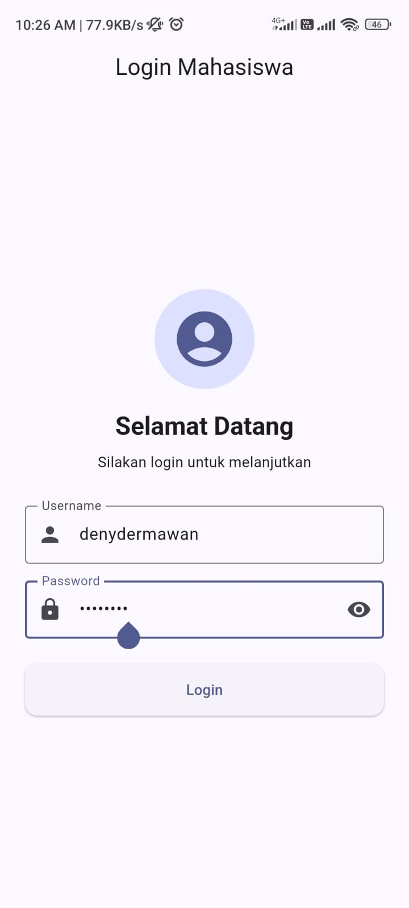
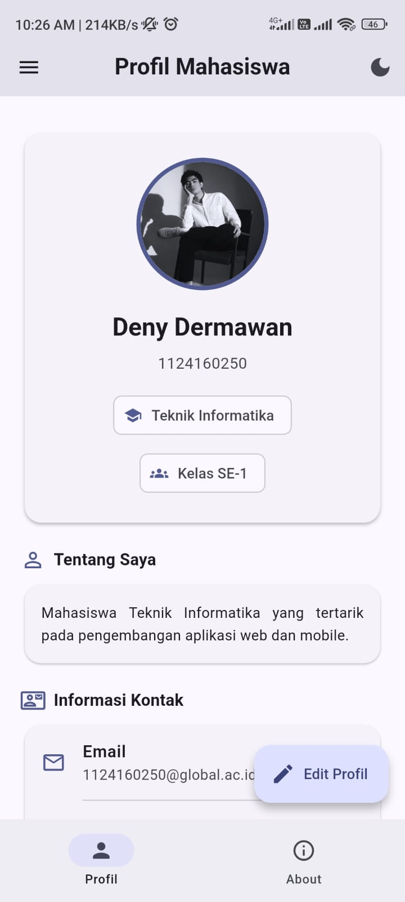
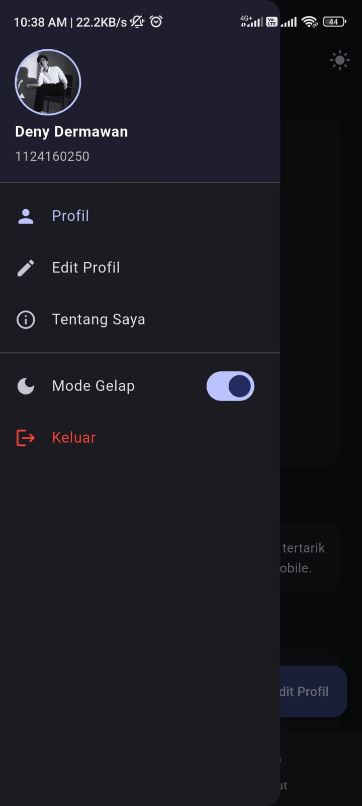
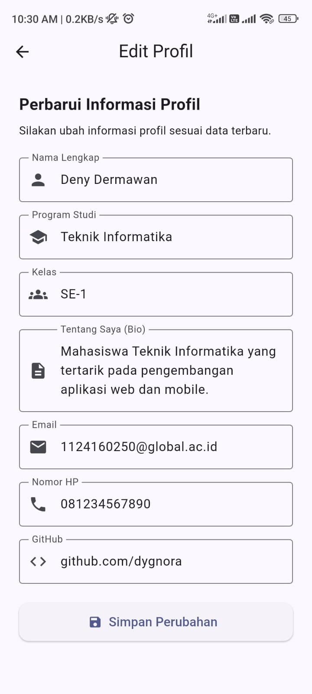
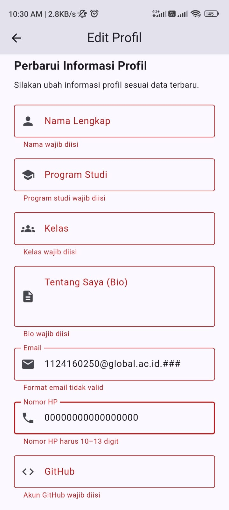
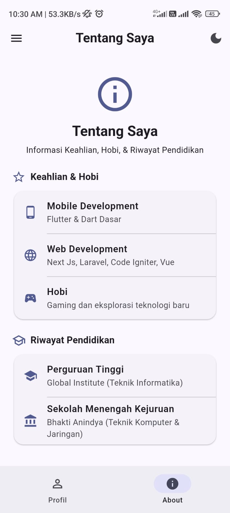

# Ujian Tengah Semester (UTS) – Pemrograman Mobile Lanjutan
**Institut Teknologi & Bisnis Bina Sarana Global**  
Semester 5 (Ganjil) 2026/2027

---

## 👤 Identitas Mahasiswa

| Data | Keterangan |
| :--- | :--- |
| **Nama** | Deny Dermawan |
| **NIM** | 1124160250 |
| **Kelas** | SE-1 |
| **Program Studi** | Teknik Informatika |
| **Dosen Pengampu**| I Ketut Gunawan, S.Kom, M.TI |
| **Repository** | [uts-pml-1124160250](https://github.com/dygnora/uts-pml-1124160250) |

---

## 🎬 Link Video Presentasi YouTube

> **Link Video:**  
> 🔗 **[Tonton Video Demo & Penjelasan di YouTube](https://www.youtube.com/watch?v=oafbht9zcfU)**  

---

## 📦 Unduhan APK Release

File APK telah dibuat dengan perintah `flutter build apk --release` dan diunggah ke GitHub Releases:

📥 **[Download app-release.apk (v1.0.0)](https://github.com/dygnora/uts-pml-1124160250/releases/tag/v1.0.0)**

---

## 📱 Daftar Fitur Aplikasi (Soal 2)

1. **Halaman Login (`login_page.dart`)**:
   - Menggunakan pola `StatefulWidget` dengan `Form` dan `validator`.
   - Validasi input: Username wajib diisi, Password minimal 6 karakter.
   - Toggle visibility password (sembunyikan / tampilkan password).
   - Simulasi loading asynchronous (2 detik) dengan `CircularProgressIndicator`.
   - Navigasi menggunakan `Navigator.pushReplacementNamed(context, '/profile')`.

2. **Halaman Profil Utama (`profile_page.dart`)**:
   - Menampilkan foto profil dari assets lokal (`assets/images/profile.jpeg`) menggunakan `CircleAvatar` berbingkai aksen warna primer.
   - Informasi identitas lengkap: Nama Lengkap, NIM, Program Studi, Kelas, dan Bio.
   - Kartu Informasi Kontak (Email, Nomor HP, Akun GitHub) menggunakan widget modular `InfoTile`.
   - Notifikasi `SnackBar` informatif saat profil berhasil diperbarui.

3. **Halaman Edit Profil (`edit_profile_page.dart`)**:
   - Form otomatis terisi data profil terkini (`TextEditingController`).
   - Validasi ketat sesuai ketentuan:
     - **Nama Lengkap**: Wajib diisi.
     - **Email**: Wajib diisi dan format email valid.
     - **Nomor HP**: Wajib diisi, hanya angka, dan memiliki panjang **10–13 digit**.
     - Program Studi, Kelas, Bio, dan GitHub: Wajib diisi.
   - Tombol **Simpan Perubahan** memvalidasi form, mengembalikan data via `Navigator.pop(context, updatedProfile)`, dan halaman profil langsung merender data baru menggunakan `setState()`.

4. **Halaman Tentang Saya (`about_page.dart`)**:
   - Menampilkan konten menggunakan `ListView`.
   - Minimal 3 Keahlian/Hobi: Mobile Development (Flutter & Dart), Web Development (Next.js, Laravel, CodeIgniter, Vue), dan Hobi.
   - Riwayat Pendidikan: Global Institute & SMK Bhakti Anindya.
   - Dibangun menggunakan widget reusable `InfoTile`.

5. **Komponen Scaffold Lengkap**:
   - **AppBar**: Dilengkapi judul dinamis dan tombol cepat alih tema mode gelap.
   - **Navigation Drawer**: Berisi `UserAccountsDrawerHeader` (foto, nama, NIM), menu navigasi cepat ke Profil, Edit Profil, Tentang Saya, Switch Mode Gelap, dan tombol Keluar (Logout).
   - **Bottom Navigation Bar**: Navigasi perpindahan tab antara halaman Profil dan About.
   - **Floating Action Button**: Tombol melayang cepat untuk edit profil yang tampil cerdas hanya pada tab profil.

6. **Tema Terang & Gelap Dinamis (Material 3)**:
   - Warna tema primer berbasis *Modern Indigo* (`0xFF3F51B5`) dengan `ColorScheme.fromSeed`.
   - Switch mode gelap interaktif di Drawer dan AppBar yang secara langsung mengubah `themeMode` aplikasi.
   - Penyesuaian kontras header drawer di mode gelap agar teks tetap mudah dibaca.

7. **Identitas Aplikasi Android**:
   - Nama aplikasi di perangkat Android telah disesuaikan menjadi **Profil Deny** melalui atribut `android:label="Profil Deny"` pada file `android/app/src/main/AndroidManifest.xml`.

---

## 📸 Screenshot Aplikasi

| 1. Halaman Login | 2. Halaman Profil (Light) | 3. Fitur Drawer (Dark) |
| :---: | :---: | :---: |
|  |  |  |

| 4. Halaman Edit Profil | 5. Validasi Edit Profil | 6. Halaman Tentang Saya |
| :---: | :---: | :---: |
|  |  |  |

---

## 📂 Struktur Proyek

```text
uts-pml-1124160250/
├── README.md                  # Dokumentasi utama proyek UTS
├── soal1_live_coding/         # Proyek Flutter Soal 1 (Live Coding)
└── soal2_profil_app/          # Proyek Flutter Soal 2 (Aplikasi Android Profil)
    ├── android/
    │   └── app/src/main/AndroidManifest.xml  # Label aplikasi: Profil Deny
    ├── assets/
    │   └── images/
    │       └── profile.jpeg   # Foto profil mahasiswa
    ├── lib/
    │   ├── main.dart          # Entry point, MaterialApp, tema, dan routes
    │   ├── models/
    │   │   └── profile.dart   # Model Profile data mahasiswa
    │   ├── screens/
    │   │   ├── login_page.dart        # Halaman Login
    │   │   ├── profile_page.dart      # Halaman Utama Profil
    │   │   ├── edit_profile_page.dart # Halaman Edit Profil
    │   │   └── about_page.dart        # Halaman Tentang Saya
    │   └── widgets/
    │       └── info_tile.dart # Reusable InfoTile widget
    └── pubspec.yaml           # Konfigurasi dependensi dan aset
```

---

## 🚀 Cara Menjalankan Aplikasi

### 1. Prasyarat
- [Flutter SDK](https://docs.flutter.dev/get-started/install) (versi 3.13 ke atas)
- Android Studio / VS Code dengan ekstensi Flutter & Dart
- Perangkat Android fisik (USB Debugging aktif) atau Android Emulator

### 2. Langkah Menjalankan
1. Clone repository ini:
   ```bash
   git clone https://github.com/dygnora/uts-pml-1124160250.git
   cd uts-pml-1124160250/soal2_profil_app
   ```

2. Ambil seluruh package & dependensi:
   ```bash
   flutter pub get
   ```

3. Jalankan aplikasi pada perangkat / emulator:
   ```bash
   flutter run
   ```

4. **Kredensial Login**:
   - **Username**: `denydermawan`
   - **Password**: `deny1234`

---

## 🛠️ Build APK Release

Untuk membuat berkas installer Android (.apk):
```bash
flutter build apk --release
```
File APK akan berada pada direktori:
```text
build/app/outputs/flutter-apk/app-release.apk
```

---

## 📚 Keterangan Dependensi
Aplikasi ini hanya menggunakan dependensi bawaan resmi Flutter SDK (`flutter`) dan `cupertino_icons` sesuai instruksi soal ujian, tanpa penambahan package eksternal yang tidak diperlukan, guna memastikan kode tetap ringan, murni, dan sesuai kurikulum pembelajaran.
